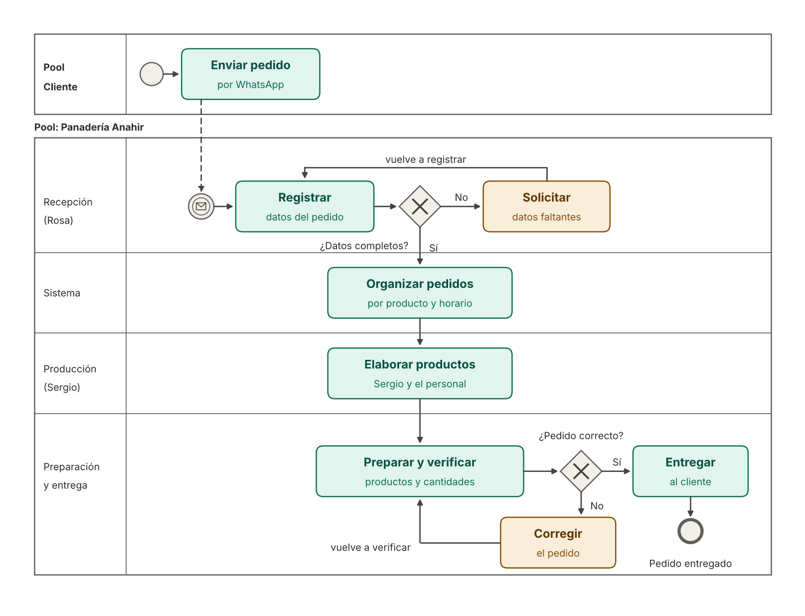

# Gestión de Pedidos y Producción – Panadería Anahir

**Materia:** Organización Empresarial
**Trabajo práctico:** Entrega N.º 4 – Procesos, trabajo colaborativo y Control Integrador
**Estudiante:** Micaela Anahir Farias

## Descripción del sistema

El proyecto consiste en desarrollar un módulo de software para la Gestión de Pedidos y Producción de Panadería Anahir.

Actualmente, los pedidos se reciben principalmente por WhatsApp, lo que requiere revisar manualmente las conversaciones para identificar los productos, las cantidades solicitadas y los horarios de entrega.

El sistema propuesto permitirá registrar los datos de los clientes y sus pedidos, incluyendo los productos, las cantidades y el horario de entrega. Además, facilitará la organización de los pedidos y la planificación de la producción, indicando al personal qué productos y cantidades debe preparar y qué corresponde a cada cliente.

## Objetivo

Mejorar la organización de los pedidos, reducir el tiempo dedicado a buscar información en WhatsApp y facilitar la coordinación entre la toma de pedidos, la producción y la preparación de las entregas.

## Integrante

Micaela Anahir Farias

## Tecnologías y herramientas

- GitHub para el control de versiones y la documentación del proyecto.
- Git para registrar los cambios realizados en los archivos.
- GitHub Projects para el seguimiento de las historias de usuario.

## Estado del proyecto

En desarrollo académico, como parte de la Entrega N.º 4 de Organización Empresarial. Las funcionalidades descriptas son una propuesta y todavía no están implementadas.

## Indicadores de desempeño

Para evaluar el funcionamiento del módulo de Gestión de Pedidos y Producción, se proponen los siguientes indicadores:

1. **Registro de pedidos:** alcanzar el registro del 100 % de los pedidos recibidos durante el período de prueba.
2. **Tiempo de consulta:** permitir consultar los datos de un pedido y sus cantidades en un máximo de 10 minutos.
3. **Organización de la producción:** organizar el 100 % de los pedidos registrados según producto, cantidad y horario de entrega.
4. **Exactitud de preparación:** pedidos entregados sin diferencias / total de pedidos preparados × 100. Requiere registrar los resultados de cada período.

Estos indicadores permitirán evaluar si el sistema contribuye a mejorar la organización de los pedidos y la planificación de la producción de Panadería Anahir.

## Tablero de seguimiento

El proyecto se organiza mediante un tablero de GitHub Projects, donde se encuentran las historias de usuario y sus estados.

[Ver tablero de GitHub Projects](https://github.com/users/anahirfarias15-sudo/projects/1)

## Diagrama BPMN

El diagrama representa el proceso de gestión de pedidos de Panadería Anahir, desde la recepción del pedido por WhatsApp hasta la preparación, verificación y entrega al cliente. Incluye dos compuertas de decisión con bucles de corrección: una para datos incompletos y otra para pedidos que requieren correcciones.

La descripción del proceso paso a paso está en [proceso-pedidos.md](proceso-pedidos.md).

## Control de versiones

La documentación se trabajó con ramas secundarias y Pull Requests. Los cambios de esta corrección se realizaron en la rama `docs/correccion-bpmn` y se integraron a `main` mediante un Pull Request. El trabajo fue individual, por lo que no hubo revisión de pares externa.

## Declaración de uso de IA

**Herramientas:** ChatGPT, para organizar y redactar partes del trabajo, y Claude (Anthropic), para interpretar las observaciones de la docente.

**Para qué se usó:** ayuda para entender las correcciones de la docente (cierre de bucles de excepción, orden de las flechas y evento de mensaje).

**Correcciones humanas:** la estudiante revisó que el diagrama y los textos reflejaran el funcionamiento real de la panadería, cargó los cambios en una rama propia, actualizó la documentación y el repositorio, y verificó que las funciones propuestas todavía no están implementadas.

La IA fue una herramienta de apoyo. La revisión, las decisiones finales y la responsabilidad por el contenido son de la estudiante.
