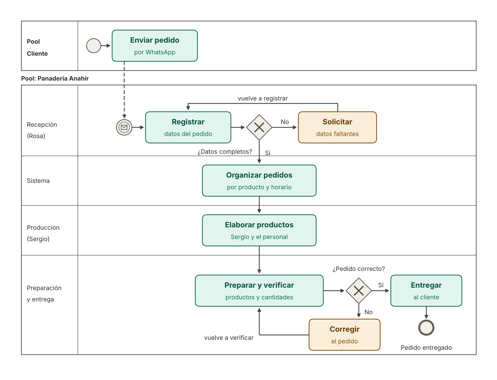

# Proceso de gestión de pedidos – Panadería Anahir

## Diagrama del proceso

## 1. Recepción del pedido

El cliente envía su pedido por WhatsApp. El mensaje es recibido por Rosa, quien se encarga de la atención y de la recepción de pedidos.

## 2. Registro de los datos

Se identifican los siguientes datos:

- Nombre y datos de contacto del cliente.
- Productos solicitados.
- Cantidades de cada producto.
- Fecha y horario de entrega.

Si falta alguno de estos datos, se solicita la aclaración al cliente y, una vez recibida, se vuelve a registrar el pedido y a verificar que esté completo.

## 3. Organización de la producción

Con los datos completos, el sistema organiza los pedidos según los productos, las cantidades y los horarios de entrega. Esta información permite planificar qué debe preparar el personal de producción.

## 4. Preparación del pedido

El personal de producción elabora los productos solicitados. Luego, se preparan las cantidades correspondientes a cada cliente.

## 5. Control y entrega

Antes de entregar el pedido, se verifica que los productos y las cantidades coincidan con lo solicitado. Si se detectan diferencias, se corrige el pedido y se vuelve a verificar. Cuando el pedido es correcto, se coordina la entrega con el cliente y el proceso finaliza.

## Objetivo del proceso

Organizar la información de los pedidos para reducir la revisión manual de conversaciones de WhatsApp, facilitar la planificación de la producción y mejorar la preparación de las entregas.
